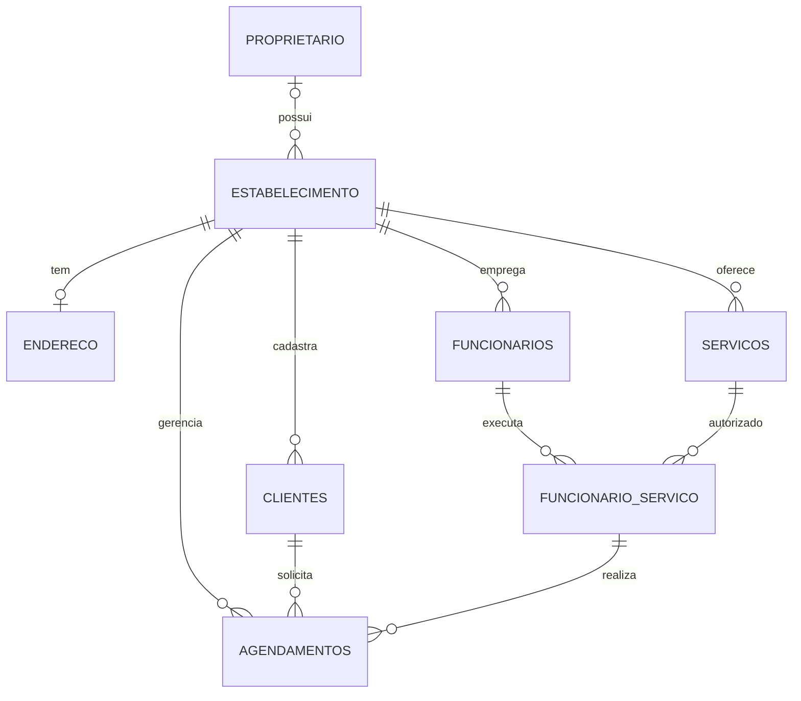

# AgenDay — Modelo relacional v2 (microtarefa 2.2)

**Status:** modelo e SQL versionados. **Ainda não importados nem testados em um servidor MySQL**.  
**Branch:** `dev-feira-uninorte`  
**Arquivo SQL novo:** [`sql/BD_v2.sql`](../sql/BD_v2.sql).

## Objetivo e isolamento

Este esquema foi planejado **somente para um banco novo, de propriedade do projeto Emds96**. O arquivo **não seleciona nem cria um banco por nome**, não traz endereço de servidor e não contém credenciais. Em um futuro phpMyAdmin, primeiro será preciso criar/selecionar o banco novo (microtarefa 2.3), e só então importar este SQL (após validação). **Nunca importar no banco do projeto original**.

O código PHP atual **continua usando nomes antigos e consultas sem filtro por estabelecimento**; portanto, este modelo **ainda não é compatível com as rotinas atuais**. A adaptação virá nas tarefas 3.x e 4.x. Não publicar ou conectar enquanto isso.

## Entidades e cardinalidades

- **`proprietario`**: titular opcional vinculado a um ou vários estabelecimentos.
- **`estabelecimento`**: entidade central; cada conta de login tem e-mail único. Armazena hash de senha com campo `VARCHAR(255)`.
- **`endereco`**: no máximo um endereço por estabelecimento (`UNIQUE id_estabelecimento`).
- **`clientes`**, **`funcionarios`** e **`servicos`**: pertencem obrigatoriamente a um estabelecimento.
- **`funcionario_servico`**: associação N:N; permite que um funcionário preste vários serviços. Chaves estrangeiras compostas impedem relações entre empresas distintas.
- **`agendamentos`**: aponta para cliente, estabelecimento e um par válido (funcionário, serviço), com início, fim e status.

## Melhorias e decisões

| Problema do modelo antigo | Decisão no v2 |
| --- | --- |
| Cadastros sem dono | `id_estabelecimento` obrigatório e chaves estrangeiras |
| Serviços do funcionário em texto | Nova tabela `funcionario_servico` |
| Sem agendamento | Nova tabela `agendamentos` com datas, horários e status |
| Telefone/CNPJ/CEP em `INT` | `VARCHAR` ou `CHAR` para preservar zeros e formato |
| Preço em `FLOAT` | `DECIMAL(10,2)` |
| Senha limitada a 50 caracteres | `VARCHAR(255)` para `password_hash()` |
| Grafia de coluna inconsistente | `email_cliente` e `descricao_servico` |
| Falta de integridade | 11 FKs, índices e restrições de unicidade |

### Compatibilidade com o PHP atual

Mudanças que precisarão acompanhar o PHP **antes da integração**:

1. `clientes.email_cliete` → `clientes.email_cliente`; atualizar cadastro e listagem.
2. `servicos.descricacao_servico` → `servicos.descricao_servico`; atualizar cadastro e consultas.
3. `funcionarios.servico_funcionario` **não existe mais**: usar `funcionario_servico` para associar serviços.
4. Inserções em `clientes`, `funcionarios` e `servicos` devem incluir `id_estabelecimento`, obtido com segurança da sessão.
5. Consultas de lista/busca/edição/exclusão devem ter `WHERE id_estabelecimento = ?` com prepared statements.
6. Cadastro/login: senha via `password_hash()` e `password_verify()`; não usar MD5 nem reaproveitar hashes antigos sem migração segura.
7. `cadastro-servicos.php` precisa omitir a coluna `id_servicos` no INSERT (auto increment).
8. Antes de marcar um agendamento, registrar os serviços realizados pelo funcionário na `funcionario_servico`.

Alguns nomes originais foram mantidos para reduzir impacto, especialmente `id_servicos`, o nome das seis tabelas originais e `arquivo_servicos` no estabelecimento.

## Regras que não são garantidas apenas pelo SQL

- Validar datas e `data_fim > data_inicio`.
- Evitar agendamentos que se sobreponham, **inclusive sob concorrência**. Estratégia prevista: transação, bloquear a linha do funcionário com `SELECT ... FOR UPDATE`, conferir interseção de horários ativos e só depois inserir/confirmar. Índice de datas, isoladamente, não impede sobreposições.
- Identificar o estabelecimento pela sessão autenticada em toda consulta/gravação. As FKs compostas ajudam na integridade, mas não substituem o controle de autorização no PHP.
- Restringir exclusões de registros referenciados por agendamentos; preferir inativação se necessário.
- Validar o formato de telefone, CNPJ, CEP, e-mail, preço e duração na aplicação.

## Ordem segura para próximas tarefas

- **2.3** Criar um banco MySQL online **com credenciais novas**, separado do original.
- **2.4** Ajustar a conexão exclusiva para esse banco, com segredos fora do GitHub, e testar o SQL em ambiente próprio; o uso real do novo esquema depende da adequação do PHP.
- **3.x** Atualizar os cadastros e autenticação para o novo esquema.
- **4.x** Implementar agendamentos e validar conflitos.

## Estado desta entrega

- ✅ Esquema novo projetado e salvo em `sql/BD_v2.sql`.
- ✅ Nomes, chaves, relacionamentos e dependências da aplicação documentados.
- ✅ `sql/BD.sql` e `sql/BD1.sql` preservados para referência.
- ⬜ Execução SQL real, migração, servidor, aplicação e credenciais: **não realizados**.
